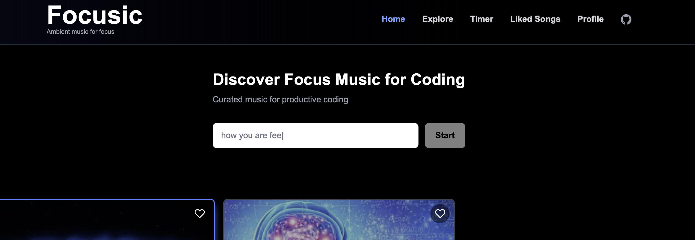
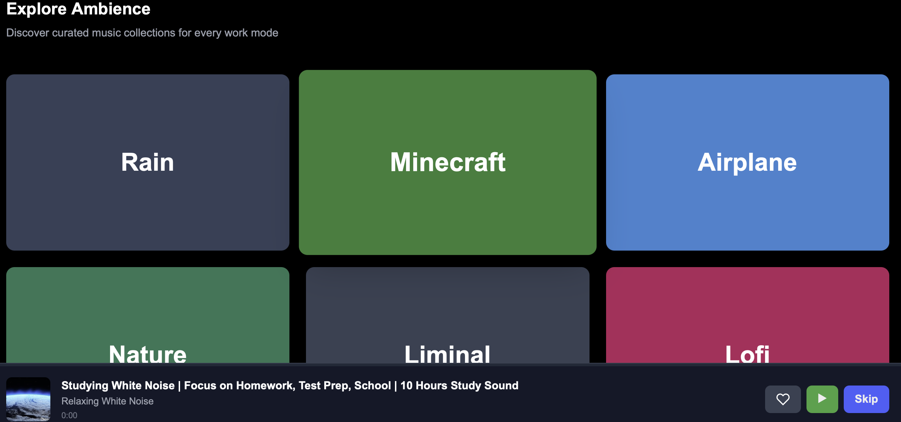
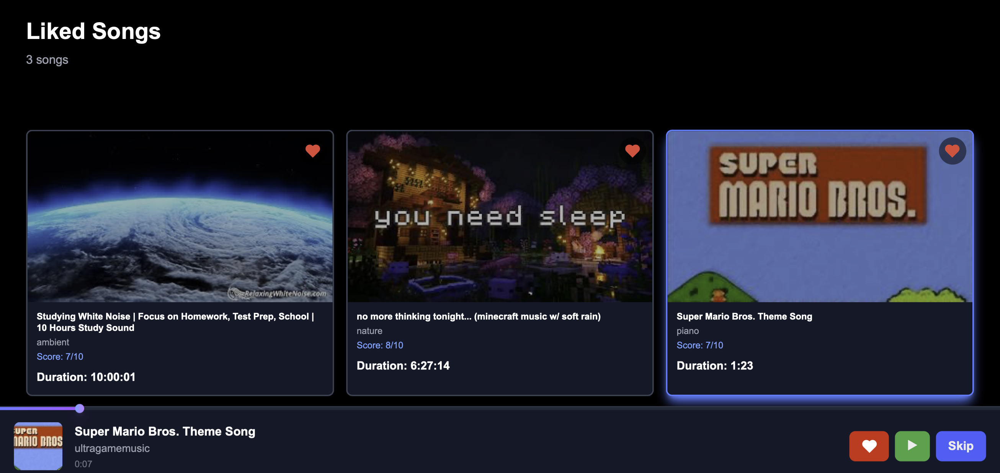
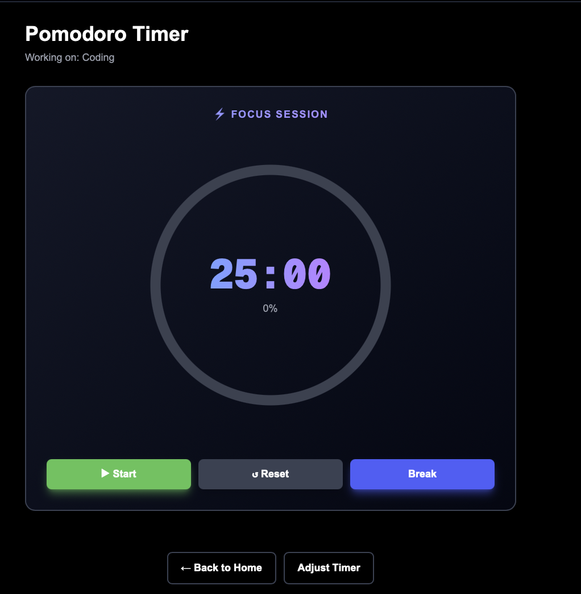

# Focusic

**AI-powered focus music meets productivity.**

Focusic is a music and productivity web application that helps you stay focused while studying, coding, or working. It combines AI-powered music recommendations, YouTube playback, and productivity tools in one distraction-free workspace.

**[ Try Focusic Live](https://focusic.vercel.app)**

## Features

- **AI-Powered Music Recommendations** — Discover music based on your listening preferences and activities, with tracks evaluated for their suitability for focused work.
- **YouTube Music Integration** — Play and explore music directly within the application.
- **Pomodoro Timer** — Customize focus and break sessions to structure your work.
- **Activity Tracking** — Track time spent on activities and develop consistent productivity habits.
- **Personalized Music Library** — Explore recommended tracks and access your liked songs.

## Tech Stack

| Technology | Purpose |
|---|---|
| Next.js | Web application framework |
| React | Interactive user interface |
| TypeScript | Type-safe development |
| Tailwind CSS | Responsive styling |
| YouTube | Integrated music playback |
| Vercel | Deployment and hosting |

## Screenshots

### Homepage

### Explore Music

### Liked Songs

### Pomodoro Timer

## Getting Started

Clone the repository:

`git clone https://github.com/shivanikadirgamarajah/focusic.git`

Navigate to the project directory:

`cd focusic`

Install dependencies:

`npm install`

Start the development server:

`npm run dev`

Open [http://localhost:3000](http://localhost:3000) in your browser.

## About the Project

Focusic was developed to explore how AI-powered music recommendations can be combined with time-management tools to create a more personalized productivity experience.

The project brings together music discovery, integrated playback, and focus-session management in a single web application.
